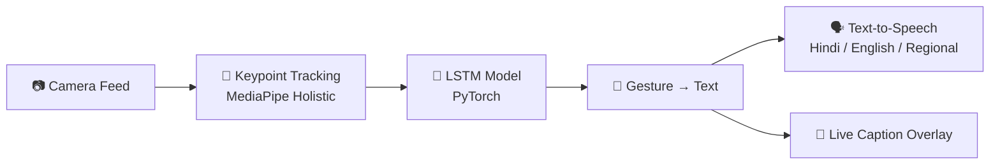

<div align="center">

# 🤟 SignBridge AI

### Real-Time Sign Language → Speech Translator

**Turning silent signs into spoken words — instantly, privately, anywhere.**

<br/>

[](LICENSE)
[](https://www.python.org/downloads/)
[](https://pytorch.org/)
[](https://fastapi.tiangolo.com/)
[](https://react.dev/)
[](https://www.docker.com/)
[](#-contributing)

<br/>

[**Overview**](#-overview) •
[**Features**](#-features) •
[**How It Works**](#-how-it-works) •
[**Quick Start**](#-quick-start) •
[**Roadmap**](#-roadmap) •
[**Contributing**](#-contributing)

</div>

---

## 🌍 The Problem

Over **466 million people** worldwide live with disabling hearing loss. Professional sign language interpreters are expensive, scarce, and rarely available on demand — leaving deaf and hard-of-hearing people struggling in everyday situations like hospitals, banks, classrooms, and shops.

## 💡 The Solution

**SignBridge AI** turns any ordinary webcam or smartphone camera into an instant sign language interpreter. It tracks hand, face, and body landmarks, understands gestures as *motion over time* using a deep-learning sequence model, and speaks the result out loud — all with **zero raw video stored**.

---

## 🚀 Overview

| | Feature | Details |
|---|---|---|
| 🤖 | **Computer Vision** | MediaPipe Holistic + OpenCV skeletal tracking |
| 🧠 | **Sequence Model** | PyTorch LSTM that recognizes gestures across frames |
| ⚡ | **Real-Time** | Streaming pipeline over WebSockets, designed for low latency |
| 🔒 | **Privacy-First** | No video frames stored or transmitted — only joint coordinates |
| 🗣️ | **Multilingual Voice** | Hindi, English, and regional language speech output |
| 📱 | **Cross-Platform** | Web app (React) and mobile app (React Native + Expo) |
| 🐳 | **One-Command Deploy** | Full stack runs with Docker Compose |

---

## ✨ Features

- 🎥 **One-click webcam access** — no special hardware required
- 💬 **Live caption overlay** — translated text appears right on the video feed
- 🔊 **Instant speech output** — recognized gestures are spoken aloud
- 🌐 **Multiple languages** — Hindi, English, and regional voice options
- ♿ **Accessibility controls** — high-contrast mode and large-text mode
- 📴 **Offline mode (mobile)** — on-device inference via TensorFlow Lite
- 🔔 **Background translation** — keeps working while the app is minimized
- 📖 **Interactive API docs** — auto-generated Swagger UI at `/docs`

---

## 🧠 How It Works



### The 3-Stage Pipeline

| Stage | File | What it does |
|:---:|---|---|
| **1️⃣ Track** | [`ai_core/services/tracker.py`](ai_core/services/tracker.py) | Uses OpenCV + MediaPipe Holistic to extract 3D skeletal joints (hands, face, pose) frame by frame. No raw pixels are retained. |
| **2️⃣ Recognize** | [`ai_core/services/model.py`](ai_core/services/model.py) | A custom PyTorch LSTM reads a *sequence* of keypoints, so it understands the fluid motion of a gesture — not just a single static pose. |
| **3️⃣ Speak** | [`ai_core/services/voice.py`](ai_core/services/voice.py) | Converts the recognized gesture to text and synthesizes speech in Hindi, English, or regional languages. |

> 💡 **Why LSTM?** Sign language is about movement. A single frame of a hand can be ambiguous, but a *sequence* of frames reveals the full gesture. LSTMs are built to learn exactly this kind of temporal pattern.

---

## 🛠️ Tech Stack

<table>
<tr>
<td valign="top" width="33%">

### 🧪 AI & Backend
- Python 3.10+
- OpenCV
- MediaPipe Holistic
- PyTorch (LSTM)
- FastAPI + WebSockets
- gTTS / pyttsx3

</td>
<td valign="top" width="33%">

### 🌐 Web App
- React 18
- Vite
- Tailwind CSS
- Native WebSocket API

</td>
<td valign="top" width="33%">

### 📱 Mobile App
- React Native
- Expo
- react-native-vision-camera
- TensorFlow Lite

</td>
</tr>
</table>

---

## 📂 Project Structure

```
SignBridge-AI/
├── ai_core/                    # 🧠 AI backend
│   ├── app/                    #    FastAPI entrypoint
│   └── services/
│       ├── tracker.py          #    MediaPipe keypoint extraction
│       ├── model.py            #    PyTorch LSTM inference
│       └── voice.py            #    Text-to-speech synthesis
├── web_app/                    # 🌐 React + Vite frontend
├── mobile_app/                 # 📱 React Native + Expo app
├── .github/workflows/          # ⚙️ CI workflows
├── docker-compose.yml          # 🐳 Full-stack orchestration
├── SignBridge_AI_PRD.docx      # 📄 Product requirements document
├── LICENSE
└── README.md
```

---

## ⚡ Quick Start

### 🐳 Option 1: Docker (Recommended)

Run the entire stack — backend API and web frontend — with a single command:

```bash
git clone https://github.com/amansingh112007-max/SignBridge-AI.git
cd SignBridge-AI

docker-compose up --build
```

| Service | URL |
|---|---|
| 🌐 Web App | http://localhost:80 |
| 📖 API Docs (Swagger) | http://localhost:8000/docs |

---

### 🧑‍💻 Option 2: Run Locally

#### Prerequisites

- Python **3.10+**
- Node.js **18+**
- A webcam or smartphone camera

#### 1️⃣ AI Core Backend

```bash
cd ai_core
python -m venv venv

# macOS / Linux
source venv/bin/activate
# Windows
venv\Scripts\activate

pip install -r requirements.txt
uvicorn app.main:app --host 0.0.0.0 --port 8000 --reload
```

#### 2️⃣ Web App

```bash
cd web_app
npm install
npm run dev
```

Open **http://localhost:5173** in your browser and allow camera access.

#### 3️⃣ Mobile App

```bash
cd mobile_app
npm install
npx expo start
```

Scan the QR code with the **Expo Go** app on your phone.

---

## 📱 Interfaces

### 🌐 Web
- ⚡ One-click webcam access
- 💬 Real-time translated text overlay on the video feed
- ♿ High-contrast mode and large-text mode

### 📱 Mobile
- 📴 On-device processing with TensorFlow Lite for offline use
- 🔔 Background translation while the app is minimized
- 📸 High-FPS frame processing via `react-native-vision-camera`

---

## 🔒 Privacy & Ethics

Privacy is a core design principle, not an afterthought.

1. **🚫 Zero Raw Storage** — Raw video frames are never stored or transmitted.
2. **🦴 Skeletal Abstraction** — The model only sees mathematical `(x, y, z)` joint coordinates. A face or identity cannot be reconstructed from this data.
3. **📴 On-Device Fallback** — The model can run entirely on-device via TensorFlow Lite for complete offline privacy.

> ⚠️ **Note:** Latency and accuracy depend on your hardware (CPU vs GPU) and camera frame rate. Real-world performance may vary.

---

## 🗺️ Roadmap

- [x] Real-time keypoint tracking with MediaPipe Holistic
- [x] LSTM-based gesture recognition
- [x] Multilingual text-to-speech output
- [x] Web and mobile clients
- [x] Docker-based deployment
- [ ] Expand gesture vocabulary beyond the current dataset
- [ ] Support additional regional sign languages
- [ ] Publish benchmark suite with latency and accuracy numbers
- [ ] Two-way translation (speech → sign avatar)
- [ ] Sentence-level recognition and grammar smoothing

---

## 🤝 Contributing

Contributions are welcome from developers, ML engineers, **sign language experts**, and accessibility advocates!

1. 🍴 Fork the repository
2. 🌿 Create your feature branch
   ```bash
   git checkout -b feature/AmazingFeature
   ```
3. 💾 Commit your changes
   ```bash
   git commit -m "Add some AmazingFeature"
   ```
4. 📤 Push to the branch
   ```bash
   git push origin feature/AmazingFeature
   ```
5. 🔁 Open a Pull Request

Found a bug or have an idea? [Open an issue](https://github.com/amansingh112007-max/SignBridge-AI/issues) — all feedback is appreciated.

---

## 🙏 Acknowledgments

- [**MediaPipe**](https://github.com/google/mediapipe) — Holistic pose, hand, and face tracking.
- [**PyTorch**](https://pytorch.org/) — LSTM model training and inference.
- [**FastAPI**](https://fastapi.tiangolo.com/) — High-performance async backend.
- The sign language datasets, consultants, and the deaf and hard-of-hearing community who inspired this project.

---

## 📜 License

Distributed under the **MIT License**. See [`LICENSE`](LICENSE) for details.

---

<div align="center">

### Built with ❤️ by [Aman Kumar Singh](https://github.com/amansingh112007-max)

*"Bridging human connection — turning silent signs into spoken words, instantly."*

⭐ **If you find this project useful, please consider giving it a star!** ⭐

</div>